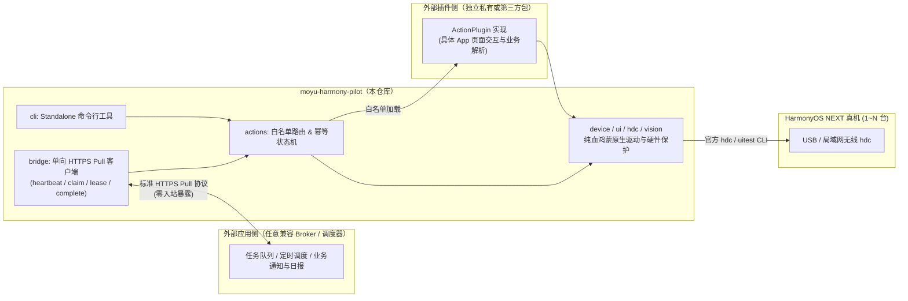

# Moyu Harmony Pilot — 需求与架构设计文档

> **文档状态**：v1，M0–M3 仓库实现与 M4 仓外应用侧端到端集成已落地，后续演进见 [roadmap.md](roadmap.md)<br>
> **目标平台**：HarmonyOS NEXT（HarmonyOS 5 / 6+，API 12+）物理设备  
> **运行宿主机**：macOS（Apple Silicon / Intel）、Linux（x86_64，兼容具备官方 `hdc` 的宿主环境）  
> **开发语言**：Python 3.11+  
> **开源标准**：当前以私有仓库孵化，全部代码、文档、测试、依赖与安全边界均按**公开开源仓库标准**建设。

---

## 1. 背景与项目定位

随着纯血鸿蒙（HarmonyOS NEXT，API 12+）彻底脱离 AOSP / Android 生态，传统基于 `adb`、`uiautomator2`、`Appium` 或手机端无障碍脚本（AutoJS / AutoX.js）的自动化方案均已失效。现有社区工具大多面向临时测试场景，普遍依赖逆向私有 `uitest` 守护进程 Socket 协议，在系统升级时易失效，且缺乏长期无人值守运行所必需的**设备互斥锁、幂等防重状态机、硬件健康保护与跨 NAT 安全任务派发能力**。

`moyu-harmony-pilot` 旨在提供一套**独立、轻量、无侵入、Agent 友好、生产级的纯血鸿蒙 Python 自动化引擎与安全任务派发桥**：

1. **作为独立开源工具（Standalone Mode）**：开发者或 AI Agent 可直接通过 Python SDK 或机器优先的 CLI 驱动本机连接的纯血鸿蒙真机，完成控件树抓取、紧凑语义快照、UI 交互、截屏诊断、健康巡检及自定义插件动作执行，**不依赖任何外部平台或云端服务**。
2. **作为边缘任务执行节点（Pull Bridge Mode）**：可通过标准、服务端无关的单向 HTTPS 出站协议，将 NAT 内网中的纯血鸿蒙真机安全接入任意兼容的外部调度器或控制面，在不暴露本地端口和调试通道的前提下完成远程任务派发与脱敏回执回收。
3. **原生面向 AI Agent 时代（Agent-Friendly First）**：从接口契约、UI 语义压缩、自描述 Schema、防失控护栏到文档与 Skill 规范，原生适配现代 Coding Agent 与 Runtime Agent（CLI-First，并支持可选轻量 MCP 薄封装），让人类开发者与 AI Agent 都能低 Token、低歧义、高安全性地开发、调试和编排纯血鸿蒙真机任务。

### 长期优先方向与变更验收

持续降低外部插件从创建、调试、离线测试、接入到升级维护的成本，并同时提升开发侧和运行侧 Agent 的易用性。这是长期优先方向，也是后续设计取舍和验收依据：

- **外部开发与开发侧 Agent**：优先提供清晰稳定的公开接口、版本兼容说明、自描述契约、通用示例和离线测试路径；插件应能在独立仓库开发和验证，避免要求修改核心代码或引入不必要的配置与依赖。涉及契约变更时同步文档、示例或测试，并说明兼容性及必要的迁移步骤。
- **运行侧 Agent**：能力、参数和副作用应可发现，结果、错误和可重试性应可机器理解；保持紧凑观测、稳定退出码，以及 `human_required` 人工接管、有副作用动作 `unknown` 只读对账和交互不确定时重新观测的路径，避免靠猜测或重复提交完成任务。
- **决策与验收**：涉及插件、执行或接入面的变更须评估上述成本与兼容影响，并以独立插件离线用例、机器可读契约及相关安全/幂等测试验证。降低成本不得削弱白名单、隐私保护、提交前账本预留和不确定状态禁止自动重放等约束；具体业务与私有配置继续留在仓外。

---

## 2. 范围与非目标（Scope & Non-Goals）

### 2.1 在范围内（In Scope）

- 仅支持 **HarmonyOS NEXT（5 / 6+，API 12+）** 原生官方调试工具链（`hdc`、`uitest`、`aa`、`bm`、`hidumper`、`power-shell`、`snapshot_display`）。
- 零手机端侵入：无需 Root、无需解锁 Bootloader、无需在手机端安装辅助测试包。
- 清晰分包的 Python 3.11+ 架构，核心层尽量零重第三方依赖。
- 面向外部插件的标准化 `ActionPlugin` 契约与 Fail-Closed 白名单加载机制。
- 本地单设备互斥、幂等三段式执行框架（`inspect → submit → confirm`）、本地脱敏诊断落盘与硬件健康遥测（电量、充电状态、电池温度）。
- 服务端无关的 Pull Bridge 协议规范与出站客户端（详见 [docs/bridge-protocol.md](bridge-protocol.md)）。
- 原生 Agent 友好能力：统一 JSON 输出信封与语义化退出码、Token 友好的紧凑 UI 语义快照（`@eN` 引用索引）、CLI/插件 Schema 自描述、`AGENTS.md` 与标准 Agent Skill 模板、防失控安全护栏，以及可选的轻量 MCP 薄适配层。

### 2.2 明确非目标（Non-Goals）

- **不支持 Android 或兼容安卓的旧版鸿蒙（HarmonyOS 2–4 / ADB）**：Android 自动化生态已高度成熟，本项目不引入任何 ADB 兼容代码或最低公分母抽象。
- **不做逆向、破壳、协议抓包或绕过安全检测**：不提供任何针对特定应用接口加密、验证码绕过、设备指纹伪造或安全机制规避能力。
- **不内置具体第三方商业/民生业务脚本**：如特定 App 的签到、抢购、业务操作脚本均属于**外部应用插件**，由使用方在独立仓库或本地插件目录中自行维护，不进入本仓库。
- **不强耦合任何特定调度系统或控制面**：任何外部调度器、集群控制面或通知平台都只是本项目的普通应用侧；本仓库不得包含任何私有域名、专有控制面概念、专有通知 SDK 或私密配置。
- **不内置复杂定时调度器（Cron 平台）**：Standalone 模式聚焦单次/受控执行，定时触发由宿主机 `launchd` / `systemd` / `cron` 或外部调度系统负责。
- **不向远端开放任意命令透传**：远程派发严禁支持任意 `hdc shell`、任意文件读写或未受控的裸坐标点击。

---

## 3. 系统边界与职责划分

`moyu-harmony-pilot` 在整体自动化拓扑中严格定位为**边缘设备驱动与受控执行层**，与上游应用侧（调度器/控制面）和横向业务侧（外部插件）彻底解耦：



### 职责边界摘要

| 角色 | 负责内容 | 不负责内容 |
| :--- | :--- | :--- |
| **外部 Broker / 调度器** | 定时计划、任务入队、Dispatcher 鉴权、业务日报与告警通知 | 不接触 `hdc`、不知道设备细节、不存截图与页面原文 |
| **`moyu-harmony-pilot`（本仓）** | 纯血鸿蒙官方驱动、UI 选择与等待、OCR 抽象、硬件遥测、单设备锁、幂等执行框架、插件加载、Pull Bridge 客户端 | 不管业务定时策略、不含私有业务 App 脚本、不耦合任何特定后端 |
| **外部 Action 插件** | 单个业务场景的 UI 状态机（`inspect / submit / confirm`）与结构化指标提取 | 不直接拼装底层 `subprocess`，不绕过驱动与白名单安全门控 |

---

## 4. 单仓分包架构与可拆库设计

前期保留单仓库维护以降低联调与发版成本，但内部按**严格单向依赖（DAG，禁止循环依赖）**分包，确保后期在需要时可将底层纯驱动 SDK 与运行时守护服务无痛拆分为独立发行包。

### 4.1 仓库与包目录规划

```text
moyu-harmony-pilot/
├── pyproject.toml
├── LICENSE
├── SECURITY.md
├── AGENTS.md                        # 面向 AI Coding Agent 的仓库契约、红线与验证 SOP
├── README.md
├── docs/
│   ├── requirements.md              # 本文档
│   ├── device-setup.md              # 本地环境与纯血鸿蒙真机准备指南
│   └── bridge-protocol.md           # 通用 Pull Bridge HTTP 协议规范
├── skills/
│   └── harmony-pilot/SKILL.md       # 标准 Agent Skill（教外部 Agent 安全调用本工具）
├── src/moyu_harmony_pilot/
│   ├── hdc/                         # L1: 官方 hdc CLI 封装、命令超时、错误分类、文件收发
│   ├── ui/                          # L2: uitest dumpLayout 解析、UiNode 树、紧凑语义快照、选择器、手势交互
│   ├── device/                      # L3: 设备抽象、alias 映射、锁、应用/电源/截屏、电池温度遥测、诊断落盘
│   ├── vision/                      # L3(可选): OcrEngine 协议、macOS Vision / RapidOCR 适配器、弹窗 Watcher、SoM 标注
│   ├── actions/                     # L4: ActionPlugin 契约、白名单注册表、插件发现、幂等账本、内置动作与示例
│   ├── bridge/                      # L5: 标准 Pull Bridge 出站客户端、心跳、租约续期、退避重连
│   ├── cli/                         # L5: 机器优先统一 CLI 入口（JSON 信封、语义退出码、Schema 自描述）
│   └── mcp/                         # L5(可选): 轻量 MCP Server 薄适配层（复用 actions/device/ui，零重复逻辑）
└── tests/                           # 全离线 Mock 测试 + 脱敏布局 Fixture（零真机依赖跑 CI）
```

### 4.2 严格单向依赖规则（DAG）

```text
hdc (仅依赖 Python 标准库)
 └── ui (仅依赖 hdc + 标准库)
      └── device (依赖 hdc, ui)          vision (仅依赖协议/可选 OCR 后端)
           └──────────────┬────────────────────────┘
                          ▼
                       actions (依赖 device, ui, vision 协议)
                 ┌────────┼────────┐
                 ▼        ▼        ▼
              bridge     cli      mcp (可选薄适配)
```

- **未来拆库切分线**：`hdc + ui + device (+ vision)` 天然构成零服务耦合的纯驱动 SDK；`actions + bridge + cli (+ mcp)` 构成任务执行、边缘接入与 Agent 工具层。只要严守上述单向依赖，拆库无需重写业务代码。
- **依赖分级（`pyproject.toml` optional extras）**：
  - 核心包（默认安装）：**仅依赖 Python 3.11+ 标准库**（Compact UI 压缩、JSON 信封、Schema 自描述与 Bridge 客户端均尽量零重依赖）。
  - `[mcp]`：可选标准 MCP Server 运行时依赖。
  - `[vision-macos]`：macOS 原生 Vision OCR 绑定（可选）。
  - `[vision-rapidocr]`：跨平台 RapidOCR 后端（可选）。
  - `[dev]`：`pytest`、`ruff` 等开发工具；静态类型检查仍在[路线图](roadmap.md)中规划。

---

## 5. 功能需求详述

### FR-1：官方 `hdc` 底层封装（`moyu_harmony_pilot.hdc`）

1. **自动与显式发现 `hdc` 二进制**：
   - 优先级：显式参数 / `HARMONY_PILOT_HDC_PATH` 环境变量 → `PATH` 查找 → 常见官方安装路径（如 macOS DevEco Studio SDK、Command Line Tools 目录）。
   - 提供版本探测（`hdc version`）与环境自检能力。
2. **设备枚举与连接状态分类**：
   - 封装 `hdc list targets`，清晰区分无设备、离线、未授权与已连接状态。
   - 所有命令显式带 `-t <target>`，从根源避免多机同时在线时的误操作。
3. **无状态官方 CLI 执行与安全约束**：
   - 禁止通过 shell 字符串拼接传入未转义参数（使用参数列表 / 严格受控参数构造），防止命令注入。
   - 所有调用强制带超时（默认命令超时如 15s，文件拉取单独配置超时），返回结构化 `CommandResult`（退出码、标准输出/错误、耗时、标准化错误枚举）。
   - 底层定义轻量 `HdcTransport` 抽象，默认实现为官方 CLI；预留未来按需扩展长连接传输层的接口，但核心稳定路径始终以官方公开 CLI 为准。
4. **安全临时文件收发**：
   - 封装 `hdc file recv` / `hdc file send` 及设备端 `/data/local/tmp/moyu_pilot_*` 临时文件清理，确保单次执行结束或异常退出后自动清理远端临时布局和截图文件，避免塞满手机 `/data/local/tmp`。

### FR-2：声明式 UI 布局解析与交互（`moyu_harmony_pilot.ui`）

1. **官方控件树抓取与强类型建模**：
   - 封装 `hdc shell uitest dumpLayout -p /data/local/tmp/<unique>.json`（按需支持 `-a` 扩展属性、`-b <bundleName>`、`-w <windowId>`），拉取后解析为强类型不可变 `UiNode` 树。
   - 解析并归一化 `bounds`（坐标矩形 `[left, top, right, bottom]`、宽高、中心点）、`text`、`id`、`type`、`description`、`clickable`、`enabled`、`visible`、`checked`、`selected` 及父子层级关系。
2. **声明式选择器与智能等待**：
   - 支持按 `text`、`text_contains`、`text_regex`、`id`、`type`、`description`、`clickable`、索引及父子节点组合查询（`find_first` / `find_all`）。
   - 提供 `wait_for(selector, timeout, interval)` 与 `wait_gone(selector, timeout, interval)`，避免脚本里硬编码脆弱的 `sleep`。
3. **官方输入原语封装（`uitest uiInput`）**：
   - 封装 `click`、`doubleClick`、`longClick`、`swipe`、`fling`、`drag`、`dircFling`、`inputText`、`keyEvent`（`Home` / `Back` / 电源等）。
   - 支持点击 `UiNode`（自动取安全中心点，支持轻微偏移校验）以及归一化比例坐标 `(0.0~1.0, 0.0~1.0)`。
4. **Token 友好的紧凑语义快照（Compact UI Snapshot）与状态差分**：
   - 实测真机原始 `uitest dumpLayout` JSON 常达 `100–200 KB`（直接输入大模型会浪费数万 Token）；`ui` 层内置确定性压缩器：自动剪枝不可见/无语义空容器、保留含文本/描述/可交互节点，并为可交互节点分配确定性短引用 `@e1`、`@e2`、…（附带类型、文本、描述与归一化坐标/中心点），将单屏上下文压缩至约 `2–4 KB`。
   - 计算当前界面结构指纹（`layout_hash`），支持交互前后对比是否发生页面跳转或节点变更，向脚本与 AI Agent 提供明确的差分反馈。

### FR-3：设备管理、硬件保护与诊断（`moyu_harmony_pilot.device`）

1. **设备别名隔离（Alias Isolation）**：
   - 通过本地配置文件（默认 `devices.local.yaml` / JSON，忽略进 Git）建立 `device_alias ↔ hdc_target_serial` 映射。
   - 全部日志、回执与 Bridge 协议均仅暴露 `device_alias`，不外泄真实硬件串号。
2. **应用与电源控制**：
   - 封装 `aa start -b <bundle> -a <ability>`、`aa force-stop <bundle>` 及当前前台窗口/包名查询。
   - 封装屏幕状态读取、亮屏/息屏控制（`power-shell`）以及无密码滑动解锁辅助（明确不内置破解或存储用户锁屏 PIN 码的机制）。
3. **硬件健康遥测与保护门控**：
   - 解析 `hidumper -s BatteryService` 获取电量百分比（`battery_percent`）、充电状态（`charging`）、电池温度（`temperature_c`）。
   - 支持配置**硬件保护阈值**（如电池温度 `>= 42.0°C` 时拒绝启动非诊断类业务任务并标记保护状态，防止长期插电挂机发生过热风险）。
4. **单设备互斥锁**：
   - 基于本地文件锁（`fcntl` / 跨平台锁目录）为每台设备提供严格互斥，既防止多任务抢屏，也从机制上避免触发 HarmonyOS `uitest` 的并发调用限制。
5. **本地脱敏诊断落盘**：
   - 封装 `snapshot_display` / `uitest screenCap` 截屏和布局快照落盘，目录权限强制 `0700`、文件 `0600`。
   - 支持自动保留上限（如按最近 N 次或最大磁盘占用滚动清理），防止长期运行撑爆宿主机磁盘。

### FR-4：可插拔视觉与 OCR 能力（`moyu_harmony_pilot.vision`）

1. **统一 `OcrEngine` 协议**：
   - 输入截图路径/字节，输出结构化 `TextBox(text, bounds, confidence)` 列表，支持按文本/正则定位屏幕点击坐标（解决 WebView / Canvas / 图片按钮在 `dumpLayout` 中无文字节点的问题）。
2. **可选后端实现**：
   - 默认不强制安装任何重依赖；未配置 OCR 后端时明确抛出可识别的 `VisionUnavailableError`。
   - 已提供 `MacOSVisionOcrEngine`（利用 macOS 原生 Vision 框架）与可选 `RapidOcrEngine`（跨平台 Linux/macOS 通用）。
3. **通用弹窗兜底（Popup Watcher）**：
   - 提供声明式规则辅助，用于在页面等待期间识别并处理常见的「稍后再说 / 关闭 / 跳过 / 取消更新」类非破坏性弹窗，且仅在显式启用的白名单规则内触发。

### FR-5：插件化 Action 框架与幂等防重（`moyu_harmony_pilot.actions`）

1. **标准 `ActionPlugin` 契约**：
   - 每个插件声明元数据：`action_id`（如 `device.health`）、`version`、`description`、`side_effect`（只读 `readonly` / 有副作用 `mutating`）、参数校验 Schema、默认超时时间。
   - **只读动作**实现 `execute(ctx, params) -> ActionOutcome`。
   - **有副作用的幂等业务动作**继承三段式基类 `IdempotentAction`，强制拆分为：
     - `inspect(ctx, params)`：只读检查当前状态（判断是否已完成、待执行、登录失效或遇人工验证）；
     - `submit(ctx, inspection, params)`：至多执行一次产生副作用的动作；
     - `confirm(ctx, params)`：提交后独立复核界面状态与业务指标。
2. **本地防重账本（SQLite）**：
   - 对于带 `idempotency_key` 的 `mutating` 动作，在调用 `submit()` **之前**先原子提交本地 SQLite 记录（阶段标记为 `submitting`）。
   - 当日/同幂等键已确认 `succeeded` 或 `already_done` 时直接短路返回 `already_done`，不重复唤醒 App。
   - 若执行超时、进程崩溃或确认失败，状态保留为 `unknown`；后续同幂等键请求**禁止自动重放 `submit()`**，只允许只读复核或等待人工介入。
3. **标准结果模型（严格白名单字段）**：
   - 状态枚举固定为：
     `succeeded`、`already_done`、`human_required`、`device_offline`、`device_overheated`、`failed`、`unknown`、`configuration_error`。
   - 允许上报的脱敏业务指标严格限定为有界结构化字段（如 `metrics: dict[str, int | float | str | None]`，键名与值长度受限），严禁把原始 UI 文本、截图、异常堆栈正文或敏感凭据写入回执。
4. **外部私有插件加载与白名单门控**：
   - 支持两种标准外部插件加载方式：
     1. Python 包 `entry_points(group="moyu_harmony_pilot.actions")`（私有独立仓库 `pip install -e` 即可注册）；
     2. 本地插件目录显式配置（`HARMONY_PILOT_PLUGIN_PATHS`）。
   - **Fail-Closed 白名单**：即使发现了外部插件，在 Pull Bridge 模式下也**仅暴露**配置文件中显式加入 `allowed_actions` 白名单的动作给远端。
5. **内置通用动作与脱敏示例（不含特定商业/民生业务）**：
   - 内置通用系统动作：
     - `device.ping`：验证 `hdc` 连通性与基本设备响应；
     - `device.health`：采集电量、充电态、电池温度、屏幕状态；
     - `ui.inspect`（仅限本地 CLI，不默认暴露给远端）：抓取并保存当前页面控件树摘要供开发调试。
   - 内置脱敏示例插件（如 `example.settings_inspect`，仅演示 `ActionPlugin` 接口写法与测试方式，默认不在远程白名单中开启）。

### FR-6：机器优先 CLI 工具（`moyu_harmony_pilot.cli`）

所有命令均按 **Agent / 自动化优先** 设计：`--json` 时 `stdout` 仅输出严格 JSON 信封、诊断日志全走 `stderr`，并保证稳定的语义退出码：

| 命令 | 说明 |
| :--- | :--- |
| `harmony-pilot devices` | 列出当前已连接的设备、别名映射状态与基础健康信息 |
| `harmony-pilot doctor` | 检查 `hdc` 路径/版本、设备连通、`uitest` 可用性、OCR 后端与本地目录权限 |
| `harmony-pilot dump-ui --device <alias> [--compact] [--out <file>]` | 抓取当前界面控件树；`--compact` 输出带 `@eN` 引用的低 Token 语义快照 |
| `harmony-pilot screenshot --device <alias> --out <file> [--max-width <px>] [--som]` | 截取当前屏幕；可选缩放与 Set-of-Mark（`@eN` 编号框）标注以服务多模态视觉 Agent |
| `harmony-pilot schema` | 输出完整 CLI 命令、状态枚举、退出码与全局契约 JSON Schema（自描述） |
| `harmony-pilot plugins list` | 列出已发现的内置与外部插件、副作用级别及其远程白名单状态 |
| `harmony-pilot plugins describe <action_id>` | 输出单个 Action 插件的参数 JSON Schema、返回指标说明与安全级别 |
| `harmony-pilot plugins validate <action_id> [--params-json ...] [--idempotency-key ...]` | **0.2.0rc1 已实现**，加载可信插件后离线预检参数与有副作用动作的幂等键，设备和远程白名单在实际执行时校验 |
| `harmony-pilot run --device <alias> --action <id> [--idempotency-key ...] [--params-json ...] [--dry-run]` | 本地执行单个动作（`--dry-run` 仅校验配置/设备/参数，不触发 UI 交互） |
| `harmony-pilot serve --config <path>` | 启动 Pull Bridge 常驻守护进程（对接任意实现 `bridge-protocol` 的远端 Broker） |

### FR-7：服务端无关的 Pull Bridge 客户端（`moyu_harmony_pilot.bridge`）

- 完整实现 [docs/bridge-protocol.md](bridge-protocol.md) 定义的客户端状态机：
  - 周期心跳（上报在线设备别名、硬件遥测、各设备白名单 `capabilities`）；
  - 主动拉取（`claim`）待执行任务并持有租约（`lease_token`）；
  - 后台心跳线程自动续租（`lease`），单任务受硬超时约束；
  - 执行结束后上报脱敏结构化回执（`complete`），支持网络抖动下的幂等重传；
  - 收到 `SIGTERM` / `SIGINT` 时停止拉取新任务、等待当前任务到达安全点并优雅释放锁后退出；
  - 断网/远端不可达时采用带抖动的指数退避重连，不影响本机已落盘账本。

### FR-8：Agent 友好能力与安全护栏（Agent-Friendly First）

为确保本项目对 **开发侧 AI Agent（写代码/开发插件）** 与 **运行侧 AI Agent（把纯血鸿蒙真机作为工具编排调用）** 都原生友好，建立以下六项硬性契约：

1. **统一结构化信封与语义退出码**
   - `--json` 模式统一输出：
     `{"schema_version": 1, "ok": true|false, "command": "...", "data": {...}, "error": {"code": "...", "message": "...", "retryable": false, "hint": "..."}}`
   - 固定语义退出码，避免 Agent 用脆弱正则解析自然语言报错：
     - `0`：成功（含 `already_done`）
     - `1`：一般执行失败（`failed` / `unknown`）
     - `2`：参数、Schema 或配置错误（`configuration_error`）
     - `3`：设备离线或未授权（`device_offline` / `unauthorized`）
     - `4`：需要人工介入（`human_required`，如验证码、掉登录、敏感确认）
     - `5`：触发硬件保护门控（`device_overheated`）
     - `6`：设备忙 / 本地互斥锁冲突（`device_busy`）
2. **低 Token 视觉与语义接口**
   - 控件树默认提供 `--compact` 紧凑语义视图（`@e1`, `@e2`, … 编号索引），显著降低上下文开销并消除坐标猜测幻觉；
   - 截屏可选缩放（`--max-width`）及 Set-of-Mark（`--som`，将 `@eN` 编号叠加绘制在截图上），直接服务多模态视觉 Agent。
3. **自描述契约（Zero-Guess Introspection）**
   - 通过 `harmony-pilot schema` 与 `harmony-pilot plugins describe <action_id>` 输出机器可读 JSON Schema、副作用等级（`readonly` / `mutating`）及示例入参，Agent 无需通读源码即可准确构造调用。
4. **双模接入面（CLI-First + 可选轻量 MCP 薄适配）**
   - **CLI-First**：任何具备终端能力的 Coding Agent 可直接以零额外依赖调用 `harmony-pilot ... --json`。
   - **可选 MCP Server（`moyu_harmony_pilot.mcp`，`[mcp]` optional extra）**：仅作为薄协议转发层，直接复用 `actions / device / ui` 内核与安全门控，严格区分两种运行模式：
     - **Safe Mode（默认）**：仅暴露只读观测工具（设备列表、健康遥测、紧凑 UI 快照、截屏）和白名单 `run_action`；
     - **Local Interactive Lab Mode（仅本地显式开启，绝不经远程 Bridge 暴露）**：用于本机探索新 App 或辅助开发外部插件，支持引用点击与输入、长按、滑动、返回、回桌面、启动应用、等待和滚动查找；直接交互返回最新紧凑快照与 `changed` 状态差分。
5. **Agent 防失控护栏（Guardrails）**
   - **步数与耗时硬预算**：交互探索与单任务执行强制设置最大步数与墙钟超时，防止 Agent 陷入死循环。
   - **操作前后差分反馈**：向 Agent 返回前台包名、`layout_hash` 是否变化及新旧焦点变化，防止无效重复点击。
   - **敏感场景强制熔断**：检测到密码输入、验证码、支付确认或高危权限弹窗时立即返回 `human_required`（退出码 `4`）并附带明确 `hint`，强制交由人类接管。
6. **仓库级 Agent 规范与标准 Skill**
   - 根目录维护 [AGENTS.md](../AGENTS.md)（架构 DAG、离线验证命令、Mock Fixture 规范与安全红线），让任意 Coding Agent 零门槛安全协作；
   - 仓库提供标准 `skills/harmony-pilot/SKILL.md`，方便外部用户一键将 `harmony-pilot` 的最佳实践与安全操作流接入主流 Agent 平台。

---

## 6. 非功能需求与安全红线

1. **安全与隐私（Fail-Closed）**
   - 凭据（如 `HARMONY_PILOT_BRIDGE_TOKEN`）仅通过环境变量或 `0600` 配置文件加载，日志与异常输出严禁打印 Token、Authorization 头或原始设备串号。
   - 远端 Broker 地址必须使用 `https://`（仅明确允许 `http://127.0.0.1` / `http://localhost` 用于本机联调和测试）。
   - 绝不向远端上传截图、完整 UI 布局树或任意原始日志正文。
   - 绝不向远端暴露任意 `hdc shell` / 裸坐标点击 / 任意文件读取能力。
2. **稳定性与并发隔离**
   - 单设备严格串行执行，避免 `uitest` 并发报错和屏幕竞争；多台设备之间允许隔离并发。
   - 单个任务或 `hdc` 子进程超时后必须强制回收子进程并清理设备端临时文件，防止僵尸进程堆积。
   - 适配 macOS `launchd` 与 Linux `systemd` 常驻运行（提供标准模板与健康探针退出码）。
3. **代码质量与离线可测试性**
   - `tests/` 全部使用 Mock / Fake `HdcRunner` 与脱敏真实布局 JSON Fixture，在无真机、无外网的 GitHub Actions CI 中 100% 可通过。
   - 强制通过 `ruff check`、`python3.11 -m compileall -q src tests`、`python3.11 -m pytest`。

---

## 7. 里程碑规划（Roadmap）

| 阶段 | 交付内容 | 验收标准 |
| :--- | :--- | :--- |
| **M0** | 私有仓初始化（按开源标准）、`README`、`LICENSE`、`SECURITY`、`AGENTS.md`、需求文档、环境与真机指南及通用 Bridge 协议文档定稿 | 文档审阅通过，边界清晰无生态耦合；本机 `hdc` 与真机通路实测通过 |
| **M1（核心驱动与 Agent-Ready CLI）** | `hdc` + `ui`（含 `@eN` 紧凑语义快照与 `layout_hash`）+ `device` 核心包 + `devices / doctor / dump-ui --compact / screenshot / schema` CLI（统一 JSON 信封与语义退出码）+ 全离线单测 | CI 全绿；本机连接真实纯血鸿蒙设备完成 `doctor`、电量温度读取、截屏及紧凑 UI 快照导出 |
| **M2（插件框架、自描述与视觉兜底）** | `actions` 契约、`plugins list / describe` 自描述 Schema、外部插件发现、SQLite 幂等防重账本、内置系统动作 + 脱敏示例插件、`vision` OCR 抽象（macOS Vision 适配与可选 `--som` 标注） | 外部独立目录挂载插件可零侵入运行；幂等防重、差分反馈、超时 `unknown` 与过温保护单测全覆盖 |
| **M3（Pull Bridge、可选 MCP 与 Skill）** | `bridge` 客户端（严格对齐 [bridge-protocol.md](bridge-protocol.md)）、`serve` 守护命令、`launchd`/`systemd` 示例、协议兼容性测试夹具、可选 `[mcp]` 薄适配层（Safe / Local Lab 双模护栏）与 `skills/harmony-pilot/SKILL.md` | 离线模拟 Broker 与 MCP 护栏端到端测试全绿（含断网重连、租约过期、幂等重传、步数/敏感页熔断与优雅退出） |
| **M4（应用侧集成 — 在本仓之外）** | 由任意外部调度系统或控制面按 [bridge-protocol.md](bridge-protocol.md) 实现服务端 Broker，并挂载独立私有或第三方插件完成端到端业务闭环 | 不改动 `moyu-harmony-pilot` 核心代码即可接入任意兼容服务端与外部插件 |

> M0–M4 里程碑已全部闭环，后续迭代方向、优先级排期与验收标准详见 [docs/roadmap.md](roadmap.md)。
